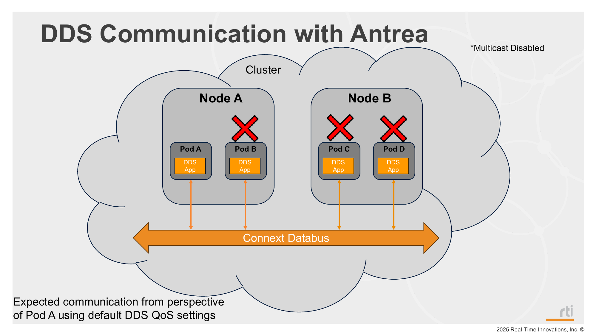

# Mode 1: Antrea CNI with Multicast Disabled



## Description

This mode runs Antrea CNI with multicast disabled and deploys Shapes publisher/subscriber.

## Steps

1. Deploy mode 1:
   ```bash
   ./_scripts/deploy_pods.sh -m 1
   ```

2. Verify Antrea and app pods:
   ```bash
   kubectl get pods -o wide
   ```

3. Verify samples are not being received/printed in pod logs:
   ```bash
   ./_scripts/get_logs.sh
   ```

## Manifests used

- `_common/pub/base/shapes_pub.yaml`
- `_common/sub/base/shapes_sub.yaml`

## Notes

- Antrea runtime config is managed by `_scripts/deploy_pods.sh`.
- Mode 1 and mode 2 share the same app manifests under `_common/pub/base` and `_common/sub/base`; the difference is Antrea multicast settings.
- `deploy_pods.sh` patches the `antrea-config` ConfigMap to enable or disable multicast depending on the selected mode. Mode 1 disables multicast.
- This mode is intended to demonstrate that each CNI has a different out-of-the-box configuration. They do not guarantee DDS communication with default QoS policies.
