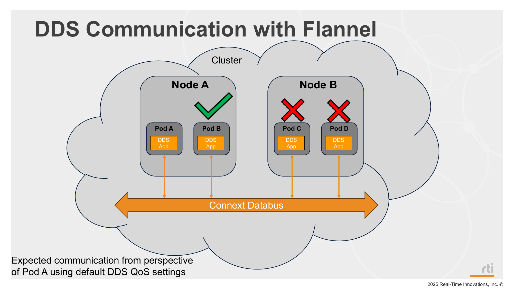

# Mode 1: Default CNI (Flannel)



## Description

This mode deploys Shapes publisher/subscriber using the default K3s Flannel networking.

## Steps

1. Deploy mode 1:
   ```bash
   ./_scripts/deploy_pods.sh -m 1
   ```
2. Verify pods:
   ```bash
   kubectl get pods -o wide
   ```
3. Verify samples are being received/printed in pod logs:
   ```bash
   ./_scripts/get_logs.sh
   ```

## Manifests used

- `_common/pub/base/shapes_pub.yaml` (BLUE on control-plane, randomly assigned color on remote workers)
- `_common/sub/base/shapes_sub.yaml`

## Notes

- DDS communication across different nodes does not work in this mode because multicast is not available with the default Flannel CNI setup.

- On a single node, local DDS communication can still work because Flannel appears to forward multicast traffic between local DDS application pods. This is an observed behavior in this setup and may not be true for every CNI implementation.