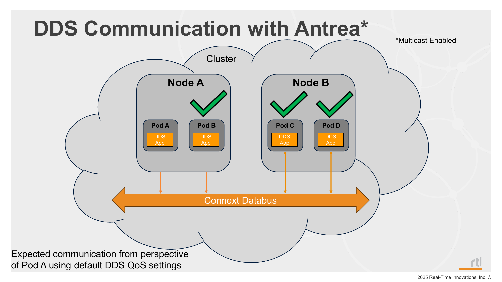

# Mode 2: Antrea CNI with Multicast



## Description

This mode runs Antrea CNI with multicast enabled and deploys Shapes publisher/subscriber.

## Steps

1. Deploy mode 2 (downloads and applies Antrea manifest, then deploys app pods):
   ```bash
   ./_scripts/deploy_pods.sh -m 2
   ```
2. Verify Antrea and app pods:
   ```bash
   kubectl get pods -o wide
   ```
3. Verify samples are being received/printed in pod logs:
   ```bash
   ./_scripts/get_logs.sh
   ```
4. Optional: take a capture from inside a pod and open it in Wireshark to confirm multicast packets from other nodes are visible.
   Use the helper script and select the remote subscriber Pod when prompted:
   ```bash
   ./_scripts/exec.sh -t
   ```
   This saves a timestamped `.pcap` file in the current directory. Open that capture in Wireshark and use a display filter such as:
   ```text
   ip.dst == 239.255.0.1
   ```
   When multicast is working across nodes, you should see packets whose source IP belongs to a Pod on a different node.

## Manifests used

- `_antrea/antrea.yaml`
- `_common/pub/base/shapes_pub.yaml` (BLUE on control-plane, randomly assigned color on remote workers)
- `_common/sub/base/shapes_sub.yaml`

## Notes

- `antrea.yaml` is downloaded and managed by `deploy_node.sh` in this repository.
- `deploy_pods.sh` patches the `antrea-config` ConfigMap to enable or disable multicast depending on the selected mode. Mode 2 enables multicast; all other modes disable it.
