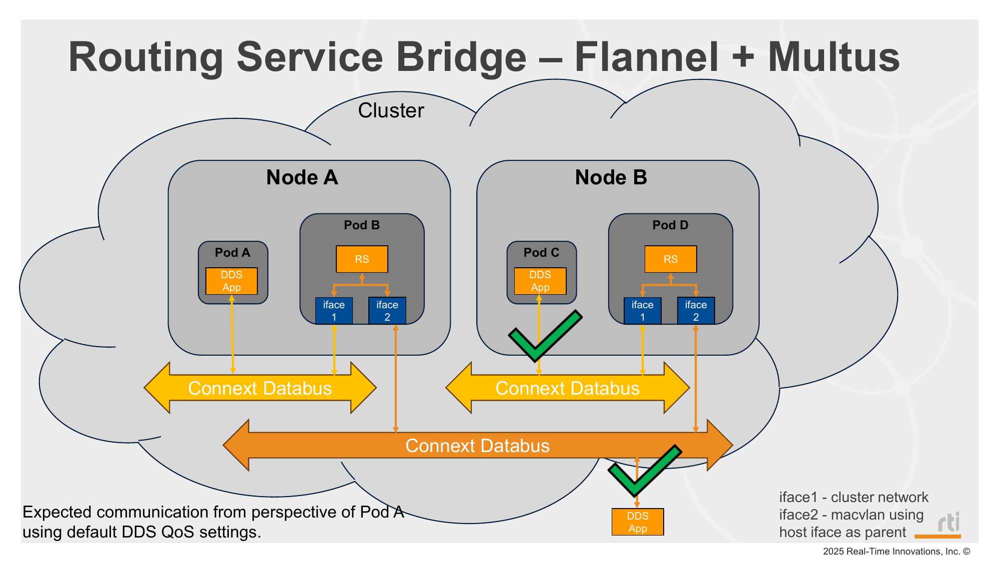
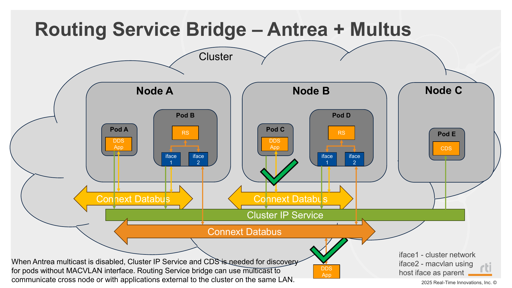

# Mode 4: MACVLAN on Routing Service Only

### Flannel



### Antrea



## Description

This mode limits pod exposure to the public network by placing only the Routing Service pod on MACVLAN, while keeping Shapes pods on the default cluster network. This is useful for security-conscious deployments or larger application sets because it reduces how many pods are directly exposed and can help limit discovery traffic within the cluster.

**Multus** is a CNI plugin that enables adding secondary network interfaces to a pod, in addition to the default cluster interface. **Whereabouts** manages IP address allocation across all of those secondary interfaces cluster-wide, ensuring each pod on any node gets a unique IP.

This configuration is particularly useful for DDS applications because the MACVLAN interface binds directly to the host's physical network interface, making multicast traffic work as it would on a regular network — without the restrictions imposed by the default CNI overlay.

**Important network behavior to be aware of:**

- Applications running directly on the host of a node **cannot** communicate with pods on that same node using MACVLAN. This is a known limitation of how MACVLAN works at the Linux kernel level. It may appear to work in some cases because traffic falls back over another interface, but this should not be relied upon.
- Applications running outside the cluster on a **different** node are able to communicate with pods inside the cluster over the MACVLAN interface. For example, if an application is running on the host of Node B, it will be able to communicate with applications running inside the cluster on Nodes A.

## Prerequisites

Before deploying, ensure each node has a static network interface configured with a fixed IP address. Using a consistent interface name across all nodes is required for MACVLAN to function correctly. See [Network Prerequisites](../../README.md#network-prerequisites) for details.

**Interface name consistency is especially important here.** When Multus creates the MACVLAN network attachment, it looks up a specific interface name on the host. If the interface name differs between nodes, the network attachment will fail to bind on nodes where the name does not match.

Before deploying, update the `master` field in `_network_attachments/macvlan-whereabouts-config.yml` to match the interface name configured on your nodes (default is `eth0`):

```yaml
"master": "eth0"
```

If nodes use different interface names, separate network attachment configs would be required per node, removing the automation this setup provides.

This mode also requires the CNI plugins assets image used by the `cni-plugins-installer` DaemonSet. Build and push it before deployment:

```bash
./_scripts/build_cni_plugins_assets_image.sh -m <mirror_registry>
```

For example:

```bash
./_scripts/build_cni_plugins_assets_image.sh -m ${STATIC_CLUSTER_IP}:5000
```


## Steps

1. Deploy mode 4:
   ```bash
   ./_scripts/deploy_pods.sh -m 4
   ```
2. Verify app pods:
   ```bash
   kubectl get pods -o wide
   ```
3. Verify samples are being received/printed in pod logs:
   ```bash
   ./_scripts/get_logs.sh
   ```

## Manifests used

### Used on both Antrea and Flannel

- `_common/pub/base/` (BLUE on control-plane, randomly assigned color on remote workers)
- `_common/sub/base/`
- `_common/rs/overlays/macvlan/`

### Antrea only

- `_common/cds/shapes_cds.yaml`
- `_common/services/cluster_ip_service.yaml`

## Notes

### Flannel

When using Flannel, multicast packets are observed to be forwarded within a node. This allows DDS discovery to complete between same-node pods without QoS changes, so Cloud Discovery Service is not required for this mode.

### Antrea (multicast disabled)

When using Antrea with multicast disabled, multicast packets are not forwarded. Therefore, Cloud Discovery Service is required to allow discovery to complete between same-node pods (publishers/subscribers/Routing Service).
