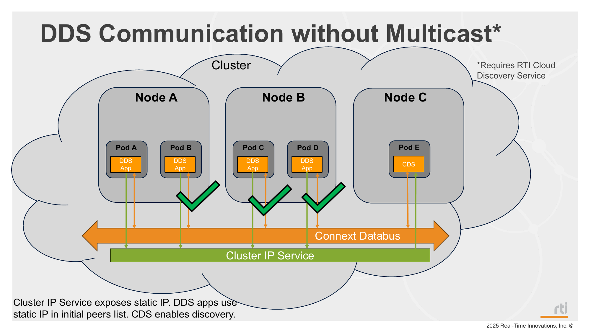

# Mode 5: Cloud Discovery Service (CDS)

## Deployment Slides



## Description

This mode deploys Cloud Discovery Service (CDS) to enable DDS discovery across the cluster when multicast is not available. It supports both local and remote app participants.

A Kubernetes ClusterIP service provides a stable in-cluster Service IP for CDS discovery traffic. Publisher and subscriber pods use this fixed service address instead of direct pod IPs, which may change when pods restart or are rescheduled.

## Steps

1. Deploy mode 5:
   ```bash
   ./_scripts/deploy_pods.sh -m 5
   ```
2. Verify CDS and app pods:
   ```bash
   kubectl get pods -o wide
   ```
3. Verify samples are being received/printed in pod logs:
   ```bash
   ./_scripts/get_logs.sh
   ```

## Manifests used

- `_common/services/cluster_ip_service.yaml`
- `_common/cds/shapes_cds.yaml`
- `_common/pub/base/shapes_pub.yaml` (BLUE on control-plane, randomly assigned color on remote workers)
- `_common/sub/base/shapes_sub.yaml`

## Notes

- Mode 5 behavior is the same with either Antrea or Flannel as the base CNI.
