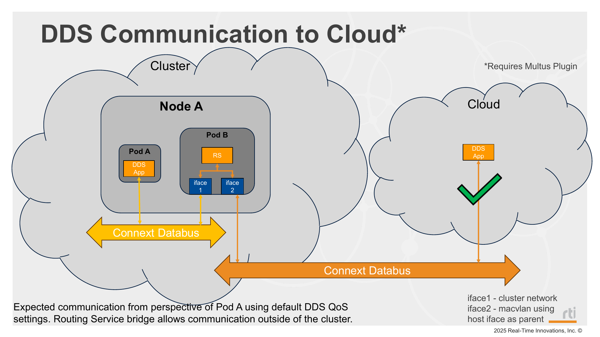
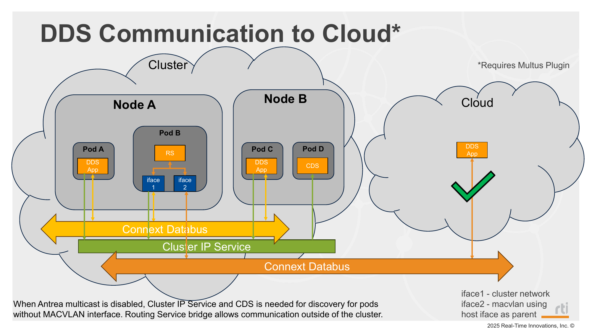

# Mode 6: Routing Service to Cloud

## Deployment Slides

### Flannel



### Antrea



## Description

This mode uses Routing Service with MACVLAN configured to integrate with the Web Integration Service hosted in the cloud.

## Prerequisites

Before deploying, ensure each node has a static network interface configured with a fixed IP address. Using a consistent interface name across all nodes is required for MACVLAN to function correctly. See [Network Prerequisites](../../README.md#network-prerequisites) for details.

**Interface name consistency is especially important here.** When Multus creates the MACVLAN network attachment, it looks up a specific interface name on the host. If the interface name differs between nodes, the network attachment will fail to bind on nodes where the name does not match.

Before deploying, update the `master` field in `_network_attachments/macvlan-whereabouts-config.yml` to match the interface name configured on your nodes (default is `eth0`):

```yaml
"master": "eth0"
```

If nodes use different interface names, separate network attachment configs would be required per node, removing the automation this setup provides.

This mode also requires the CNI plugins assets image used by the `cni-plugins-installer` DaemonSet. Build and push it before deployment:

```bash
./_scripts/build_cni_plugins_assets_image.sh -m <mirror_registry>
```

For example:

```bash
./_scripts/build_cni_plugins_assets_image.sh -m ${STATIC_CLUSTER_IP}:5000
```

## Steps

1. Deploy mode 6:
   ```bash
   ./_scripts/deploy_pods.sh -m 6
   ```
2. Verify Routing Service and app pods:
   ```bash
   kubectl get pods -o wide
   ```
3. Verify samples are being received, open:
   ```bash
   http://50.18.214.8:8080/websockets/simple_shapes_demo/js/
   ```

## Manifests used

### Used on both Antrea and Flannel

- `_common/pub/base/` — publisher (BLUE on control-plane, randomly assigned color on remote workers)
- `_common/rs/overlays/macvlan/` — routing service with MACVLAN

### Antrea only

- `_common/cds/shapes_cds.yaml` — Cloud Discovery Service
- `_common/services/cluster_ip_service.yaml` — in-cluster CDS service

## Notes

### Flannel

When using Flannel, multicast packets are observed to be forwarded within a node. This allows DDS discovery to complete between same-node pods without QoS changes, so Cloud Discovery Service is not required for this mode.

### Antrea (multicast disabled)

When using Antrea with multicast disabled, multicast packets are not forwarded. Therefore, Cloud Discovery Service is required to allow discovery to complete between same-node pods (publishers/subscribers/Routing Service).
