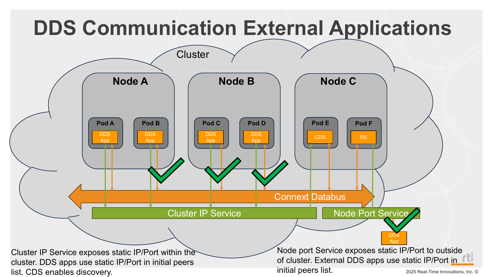

# Mode 7: External Access via NodePort

## Deployment Slides



## Description

This mode exposes Routing Service to external DDS applications. The Routing Service uses Real-Time WAN transports, and a Kubernetes NodePort service provides a stable node address and port for external clients to reach it.

NodePort works by opening the same port on each Kubernetes node and forwarding traffic to the target service in the cluster. This lets external applications connect through `node-ip:node-port` instead of requiring direct pod IP access.

Inside the cluster, Cloud Discovery Service (CDS) handles discovery. A Kubernetes ClusterIP service gives CDS a stable in-cluster service IP so publisher and subscriber pods can use a fixed address even when pod IPs change.

## Steps

1. Deploy mode 7:
   ```bash
   ./_scripts/deploy_pods.sh -m 7
   ```
2. Verify services and pods:
   ```bash
   kubectl get svc
   kubectl get pods -o wide
   ```
3. Start an external DDS application in Domain 1 outside the cluster using the provided QoS profile:
   Import `_example/external_app_qos/USER_QOS_PROFILES.xml` into Shapes Demo (or copy it into the root directory of your external Shapes application build).
4. Verify samples are being received/printed in pod logs:
   ```bash
   ./_scripts/get_logs.sh
   ```

## Manifests used

- `_common/services/node_port.yaml`
- `_common/services/cluster_ip_service.yaml`
- `_common/pub/base/shapes_pub.yaml` (BLUE on control-plane, randomly assigned color on remote workers)
- `_common/sub/base/shapes_sub.yaml`
- `_common/rs/overlays/nodeport/` (routing service nodeport overlay)
- `_common/cds/shapes_cds.yaml`

## Notes

- Mode 7 behavior is the same with either Antrea or Flannel as the base CNI.

- The `_example/external_app_qos/` directory contains `USER_QOS_PROFILES.xml`, a QoS profile for an external DDS application connecting to the cluster via NodePort. It configures UDPv4_WAN transport and sets the Routing Service NodePort address (`node-ip:node-port`) as the initial peer.

- `./_scripts/update_static_ip.sh <control_plane_ip>` automatically updates this file for you, including the static cluster IP placeholder (`<Static_Cluster_IP>`) in the `<initial_peers>` code block.